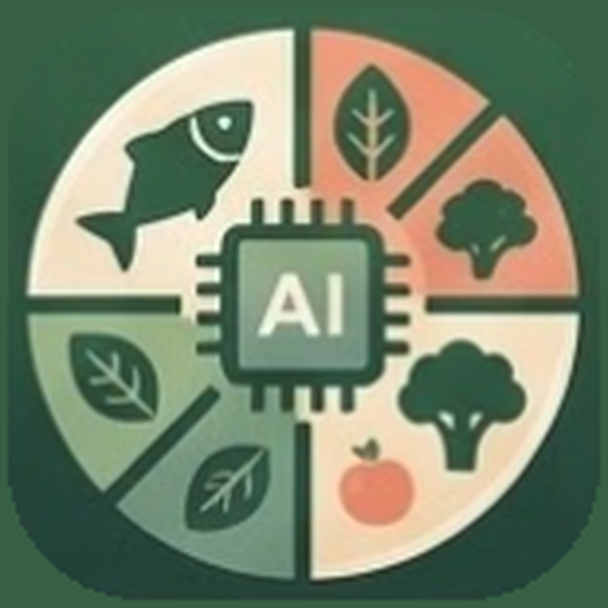

<p align="center"></p>

<h1 align="center">My Nutrition AI</h1>

<p align="center"><b>A private, on-device AI nutrition assistant for Android.</b></p>

<p align="center">
<a href="https://github.com/PartORG/My_Nutrition_AI/actions/workflows/android.yml"></a><br>
<a href="https://github.com/PartORG/My_Nutrition_AI/releases/latest">Latest release</a> ·
<a href="https://partorg.github.io/My_Nutrition_AI/">Privacy policy &amp; terms</a>
</p>

My Nutrition AI plans meals, logs food, tracks nutrients and answers nutrition questions through an
AI chat. The language model, the embeddings and all personal data stay on the phone. There are no
accounts, no cloud inference and no analytics SDK.

<p align="center">


<br><sub>Eva, the assistant, in the poses the app shows her in</sub>
</p>

## Contents

- [Features](#features): [chat and voice](#chat-and-voice) · [food logging and the camera](#food-logging-and-the-camera) ·
  [goals, dashboards and history](#goals-dashboards-and-history) · [recipes, plan and shopping](#recipes-plan-and-shopping) ·
  [health](#health) · [profile, looks and languages](#profile-looks-and-languages)
- [Plans](#plans)
- [Data](#data): [medical data](#medical-data) · [food data and vitamins](#food-data-and-vitamins) ·
  [translated ingredient names](#translated-ingredient-names)
- [Privacy](#privacy)
- [Development](#development): [requirements](#requirements) · [getting started](#getting-started) ·
  [testing](#testing) · [CI/CD](#cicd) · [project structure](#project-structure)
- [Disclaimer](#disclaimer) · [License](#license)

## Features

### Chat and voice

- **AI chat:** Gemma 4 runs locally with native tool calling. The model routes requests and
  phrases the answers. Code computes the numbers and the database supplies the facts, so nutrition
  values and recipes appear as cards from the database, never as model-generated text. When the model answers
  "I ate…" without calling a tool (even "Saved! Anything else?"), the app's own parser shows the meal card anyway:
  nothing is saved until you tap Save.
- **Talk to the assistant:** tap the mic in the chat and speak; Gemma 4 itself writes down what you said (no
  offline speech pack needed), and the answer is read aloud in a woman's or a man's voice (Settings → Voice; the
  phone's own offline voices). The recording is deleted as soon as it is written down.
- **Eva and you:** the assistant is Eva, the developer's salt-and-pepper miniature schnauzer: her face in the chat,
  the tab bar and on the unlock screen, and elsewhere a pose that fits the moment: waving on the welcome screen and
  in a new chat; sitting through the food data download, on Today's "set your goals" card and on Goals; asleep in
  an empty History or health journal; eating when Log finds no food or the shopping list is empty; thinking while
  she answers, when she knows nothing about you yet, with no saved recipes or too few weigh-ins; with a camera on a
  photo card or a review that found nothing; peeking from the drawer. Never twice on one screen. Your own picture
  (Settings → Your picture: a sheet with the picture large on top and Picture / Colour / Shape tabs) is a photo from
  your phone or one of 17 icons on one of 18 colours, solid, gradient or
  soft; in a circle, rounded square, hexagon or flower, with or without an outline.
- **Home-screen widget:** small, medium and large sizes with today's calories (opt-in), a Log button and a mic:
  say what you ate and the chat shows the meal card to check and save.
- **Memory you control:** the assistant remembers facts only after you confirm them. You can view,
  edit or delete everything it knows about you.

### Food logging and the camera

- **Food logging:** search about 41,500 foods and dishes (government tables of the US, UK, France, Canada, the Nordics
  and more, plus 503 chain menu items) and 169,000 recipes, or log by chat, voice or photo. Amounts can be grams,
  kg, ml, litres, oz, lb, fl oz, tablespoons or teaspoons, or servings ("2 eggs", "a cup of rice"). Tap "+" on a
  meal to log straight into it, or repeat yesterday's meal in one tap.
- **Camera, also in the chat:** photo and live modes, or a photo from the gallery. Gemma 4 vision names the foods
  and estimates portions (looking at the whole photo and a closer crop, then choosing among the closest database
  foods; foods it isn't sure of are marked "Check this", fried food offers "cooked with oil?", and your
  corrections are remembered for next time), and the detector draws live boxes and acts as a fallback. Shooting
  (photo or live) freezes the frame: you see the exact picture being named, with its boxes, while Gemma works.
  From Log, the review shows that photo on top (pinch to zoom) with the foods marked, and the editable list in a
  sheet you pull down to look or up to edit; in the chat ("Photo of your meal" above the input) the foods come back
  as a meal card with the photo as a thumbnail (tap for full screen), to check, change, assign to a meal and save,
  or to ask "What can I cook?". Boxes are drawn only where the detector agrees with a food on the list, named as
  the list names it; gallery photos are boxed too. The photo stays in memory only and is never stored.
- **Fix what the AI got wrong:** on the chat meal card and the photo review, tap a food to swap it,
  remove it, add one, or change the amount (also by half servings) before saving. Every log can be
  undone, and a meal on Today can be changed later (food, amount or meal).
- **Own food detector (in testing):** a YOLOX-Tiny model trained on 164 food labels (MyFoodRepo / Food Recognition
  2022, CC BY 4.0), int8 TFLite, 5.4 MB, validation AP 30.9. On a Xiaomi 11T it runs in 21 ms on NNAPI (the
  phone's AI chip, same results as the CPU), 53 ms on the GPU and 146 ms on the CPU. Photos are also searched
  in four overlapping quarters, so small foods are found too. It will replace EfficientDet once real meal photos
  confirm it; for now only the developer benchmark (Settings → About in `DEV_BILLING` builds) runs it.
  Training and export: `tool/detector_data.py`, `tool/yolox_tiny_food.py`, `tool/detector_export.py`.

### Goals, dashboards and history

- **Daily goals** (`lib/data/goals.dart`), with a manual override for every value:
  - calories: Mifflin-St Jeor resting burn × activity level (1.2–1.9), −15 % to lose or +15 % to gain, never under
    1,200 kcal (women) / 1,500 kcal (men). With a BMI under 18.5, or while pregnant, "lose" keeps the maintain
    calories and says why. Pregnancy adds 0 / 340 / 452 kcal by trimester, breastfeeding 330 / 400 kcal for a baby
    0–6 / 7–12 months old (NASEM), both asked on the Goals form;
  - protein 1.2 g per kg (above BMI 25, per kg of the adjusted weight: the BMI-25 weight plus 40 % of the rest),
    fat 30 % of calories, carbohydrate the rest, fibre 14 g per 1,000 kcal;
  - limits: total sugars 18 % of calories (the EU reference intake, 90 g of 2,000 kcal; WHO's 10 % is for free
    sugars only, which food tables don't separate), sodium 2,000 mg (WHO); conditions only ever tighten them;
  - vitamins, minerals, fatty acids and amino acids (56 nutrients in all): NASEM reference intakes for your sex,
    age and pregnancy or breastfeeding, with the upper limits food can pass;
  - water: 30 ml per kg in whole glasses, +300 ml in pregnancy, +700 ml while breastfeeding (EFSA).
  Age counts from the birth month, so the adult formulas start exactly at 18; under 18 there are no computed
  targets.
- **Dashboards:** Today, Week (with a weekly review), Month and Year views, water tracking, fasting,
  streaks and an Android home-screen widget. Totals that include estimates are marked "≈". A weight
  trend screen shows a smoothed trend line over 1, 3, 6 or 12 months, so a heavy morning isn't
  mistaken for a real change.
- **History:** meals day by day and the recipes you cooked (how often, when last), for a date range
  you pick; tap a recipe to open it.

### Recipes, plan and shopping

- **Plan, recipes and shopping:** plan the week and swap any meal. The recipe box holds what you
  saved, cooked or rated 4★+, searches every recipe, and suggests recipes from what's in your
  fridge. The shopping list is grouped by aisle and shows which recipe each item is for.
- **Recipes and Cook mode:** a servings stepper scales the amounts and nutrition. Add a recipe to
  the plan, log a serving, or cook it step by step: the screen stays on, each step shows the
  ingredients it uses, and a timer starts when the step names a time. Cook mode follows the light or dark theme like every screen.

### Health

- **Allergies and conditions:** recipes containing your allergens are always filtered out.
  Conditions (type 2 diabetes, high blood pressure, gout, ALS, multiple sclerosis) come from
  published clinical guidelines: they cap daily limits (they only ever *tighten*), hide recipes
  with foods the guidelines say to avoid, and back the assistant's health answers with cited
  passages. See [Medical data](#medical-data).
- **Health journal:** symptoms and readings on a timeline, plus a PDF/CSV export for your doctor.
  The app records data and never interprets it.
- **Health Connect / Apple Health:** reads weight, steps and burnt calories. Steps are the larger of Health
  Connect's combined count and the largest single app's own count: the combined count takes each minute from one
  app only, by the priority list in Health Connect, so an app ranked above Google Fit that counted less used to
  hide Fit's steps. Burnt calories are active calories, or for Google Fit, which writes only totals and in batches
  that trail the clock, the total minus your resting burn for the hours Fit's records cover. Burnt calories show as
  a second ring on Today, next to the calories left, and are never added to the goal (it already counts your
  activity level). Steps refresh
  while the app is open; disconnect from the steps tile or in Settings.

### Profile, looks and languages

- **One profile per phone:** sign-up is a name and a PIN, then the goals (sex is asked once, there, and the
  avatar follows it). Unlocked by fingerprint, with a PIN as the fallback. You can change the
  PIN in Settings. Signing up with Google is optional (see Build flags), and the account can be linked
  or unlinked later. Nothing leaves the phone.
- **Navigation and looks:** a bottom bar (Today, Chat, Log, Plan, Me) and a drawer with the same tabs plus the
  screens a few taps deep (weight, history, goals, health, all nutrients, photo of a meal, saved recipes,
  shopping list, what the AI knows). The colours are the app icon's: forest green, sage, cream and peach (green
  for health and progress, warm peach and coral where food and streaks are, as warm hues go with appetite), on a
  warm cream base in light mode, never pure white; every text colour keeps at least 4.5:1 contrast (WCAG AA,
  checked by `test/theme_test.dart`). Every screen, menu and dropdown takes its colours from the theme, light or
  dark, and text is set a notch (8 %) below the system size so menu items and buttons fit on one line; the
  phone's text-size setting still scales it.
- **Languages:** English, Ukrainian, German and French, chosen in Settings or the app bar (or
  follow the phone). The assistant answers in the chosen language.
- **Safety:** a medical disclaimer under the chat input, on every health-information card and in
  Settings → About. The assistant never diagnoses or advises on medicines, and a keyword check
  shows helpline information before the model runs when a message suggests a crisis.

## Plans

| Tier | Adds |
|---|---|
| **Free** | 30 chat messages a day, recipe search, logging, allergen filtering, Today/Week/Month dashboards with weight trend, fingerprint/PIN lock, meal reminders, 30 days of history |
| **Basic** | Unlimited chat, meal plan and shopping list, water reminders, micronutrients, streaks, 3 months of history |
| **Medium** | Conditions, health journal, timeline, doctor export, 8 months of history |
| **Pro** | Camera recognition, Year dashboard, 12 months of history (7-day free trial) |

History limits only what you can browse: older logs stay on the phone and come back when you upgrade.

One subscription per phone. Billing runs through RevenueCat (see
[`docs/BILLING_SETUP.md`](docs/BILLING_SETUP.md)).

## Data

### Medical data

The medical part of `nutri.db` is curated by hand in [`db/medical.sql`](db/medical.sql) from
clinical guidelines (ADA Standards of Care 2026, Diabetes Canada, Diabetes UK, NICE NG17/18/28/42/
69/136/219/220, ESC 2024 hypertension, Hypertension Canada 2025, NHLBI DASH, ACR 2012/2020 gout,
ESPEN 2018 neurology, EAN 2024 ALS, MND Association, MS Society, HealthLinkBC, AED, RCPsych MEED,
US and Canadian dietary guidelines). Every row names its guideline; passages are paraphrased, not
copied.

| Condition | Daily limits | Recipes hidden (foods to avoid) |
|---|---|---|
| Type 2 diabetes | sodium ≤ 2,300 mg, sugar ≤ 50 g | sugar-sweetened drinks |
| High blood pressure | sodium ≤ 2,000 mg, sugar ≤ 50 g | – |
| Gout | – | organ meats, sugar-sweetened drinks |
| ALS | – (needs *more* energy: covered in passages) | – |
| Multiple sclerosis | – | – |

Only foods a guideline says to **avoid** are hidden; foods it says to *limit* are explained in the
passages instead. 51 passages cover these conditions plus eating disorders (refeeding risk, warning
signs) and general healthy eating; the assistant's `condition_info` tool shows the best two with
their source. The guideline PDFs themselves are not in this repository (publisher copyright).

To change the medical data, edit `db/medical.sql` and apply it to an existing database in under a
second (the full build applies it too):

```bash
python3 tool/build_medical.py assets/nutri.db
```

When the data changes, bump `data_version` in `db/medical.sql` **and** `nutriDataVersion` in
`lib/data/nutri_db.dart`: phones replace their installed `nutri.db` once when the app expects a newer
version, then publish release `data-<version>` (see the header of
[`.github/workflows/android.yml`](.github/workflows/android.yml)).

### Food data and vitamins

`nutri.db` (catalogue v4, data version 6) holds about 41,500 foods (dishes and 503 chain menu items among them) and
169,000 recipes; `health.db` the reference intakes, the conditions of `db/medical.sql` and 16,000 health Q&A passages.
The app downloads both on first run, with the search model, from the public release `data-<version>`; there are no
packaged products (removed in v0.18). Every source and its licence: [docs/DATA_SOURCES.md](docs/DATA_SOURCES.md).

- **Foods** come from government tables first (USDA SR28, FoodData Central, CoFID, CIQUAL, CNF, NZ FOODfiles,
  AFCD, Frida and the other Nordic tables), then smaller datasets. The EU tables list carbohydrate without fibre;
  the build adds it back, so every `carbs_g` is a total as in USDA.
- **All 56 nutrients on every food:** a value a table didn't measure is borrowed from the same food in a more
  authoritative table, else the median of that food's rows, else estimated from the five most similar foods,
  scaled by its base (amino acids by protein, fatty acids by fat). Each value records its origin; the app marks
  borrowed and estimated values "≈", and a day's total is "at least" when a food doesn't know a value.
- **Researched values** (`db/catalog/manual_values.tsv`) override estimates: the USDA iodine database, and biotin
  from Staggs et al. 2004 (HPLC), which also replaces table values more than 3× off it (older microbiological
  assays ran several times high; plain cow's milk: 0.11 µg/100 g, not 2–4).
- **Recipes:** nutrition per serving is summed from the ingredient lines, with how many lines knew each value.

The pipeline is `tool/catalog` (normalize → match → fill → servings → write; `pytest tool/catalog`). Raw data
lives next to the repository (`nutrition-ai-assistant/data/`).

### Translated ingredient names

Recipe ingredients (the ~2,100 foods used in recipes) show in Ukrainian, German and French from
[`db/food_names.tsv`](db/food_names.tsv): one row per food with its English name and the three
translations, machine-translated by [TranslateGemma](https://ollama.com/library/translategemma) 4B
and open to review. A reviewed cell is never overwritten; fix a name by editing the file. The recipe
card says "Ingredient names machine-translated" whenever it shows one.

Recipe steps are translated on the phone, free, when the user taps **Translate steps**: the on-device
Gemma model writes them a few lines at a time (numbers, units and temperatures kept as written), the
card labels them as machine-translated with **Show original** one tap away, and each recipe's
translation is saved in the profile's `user.db`, so it's done once. It runs between chat turns, since
one model serves one conversation at a time on a phone.

```bash
ollama pull translategemma:4b
python3 tool/food_names.py translate assets/nutri.db  # fills missing names; resumable
python3 tool/food_names.py apply assets/nutri.db      # writes the food_names table (the full build does too)
```

A food renamed in a rebuild makes its row stale: `apply` skips it and `translate` redoes it.

## Privacy

- All inference runs on the device through [`flutter_edge_ai`](https://pub.dev/packages/flutter_edge_ai)
  (LiteRT-LM, GPU with a CPU fallback).
- Personal data lives in per-profile SQLite databases on the phone. Android Auto Backup includes
  only the profile data, never the models or caches.
- Voice stays on the phone: chat recordings are a temporary file that Gemma 4 writes down and the app then
  deletes; spoken answers use only the phone's installed offline voices.
- There is no analytics or crash-reporting SDK. Network access is limited to downloads the user starts: the food
  data and search model (first run, and once per data update) and the chat model.

## Development

### Requirements

| | |
|---|---|
| Device | Android 10 (API 29) or later, arm64, **6 GB RAM or more** |
| Chat model | Gemma 4 E2B (2.6 GB), downloaded in the app on first use; Gemma 4 E4B is optional on 8 GB phones |
| Build | Flutter 3.47 (stable), Dart 3.13, JDK 17, Android SDK |

### Getting started

```bash
git clone git@github.com:PartORG/My_Nutrition_AI.git
cd My_Nutrition_AI
flutter pub get
```

The app is small: on first run it downloads its food data and the search embedder (≈370 MB, gzipped)
from the public release `data-<nutriDataVersion>`. To work on the data locally, fetch the same files:

```bash
v=$(grep -oP 'const nutriDataVersion = \K\d+' lib/data/nutri_db.dart)
gh release download data-$v --dir assets && gunzip assets/*.gz   # nutri.db, health.db, embedder
```

Run on a connected device:

```bash
flutter run --release --dart-define=DEV_BILLING=true   # developer tier switch, no payments
```

#### Build flags

| Flag | Effect |
|---|---|
| *(none)* | Free-only build |
| `--dart-define=DEV_BILLING=true` | Developer tier switch for testing the paid features, and the detector benchmark in Settings → About |
| `--dart-define=REVENUECAT_KEY=goog_…` | Real Google Play subscriptions |
| `--dart-define=GOOGLE_CLIENT_ID=….apps.googleusercontent.com` | "Continue with Google" at sign-up and "Sign in with Google" on the lock screen. Needs an Android OAuth client (package name + SHA-1 of the signing key) and a Web client in Google Cloud Console; pass the **Web** client id. Android only for now |
| `--dart-define=AGENT_THINKING=true` | Gemma 4 thinks before answering. Slower; compare with the eval first |

#### Release builds

The CI release APK is built with `DEV_BILLING=true` for now (no RevenueCat yet).

```bash
flutter build apk --release --target-platform android-arm64        # sideloadable APK
flutter build appbundle --release --target-platform android-arm64  # Play Store
```

Builds are arm64 only. Signing reads `android/key.properties` (git-ignored); without that file,
release builds fall back to the debug key. For the Play Store steps, see
[`docs/PLAY_RELEASE.md`](docs/PLAY_RELEASE.md).

### Testing

```bash
flutter test                                    # host tests (fake model, test/nutri_test.db)
flutter test integration_test/agent_eval_test.dart   # on a phone: tool-calling accuracy of the real model
#   --dart-define=PROMPT=legacy   the v0.6 prompt + reply tool, as the baseline
#   --dart-define=THINKING=true   with Gemma 4 thinking
cd tool && uv run --with pytest --with duckdb --with openpyxl pytest   # nutri.db builders and medical data
```

The host tests cover the agent and its tools, memory, goal formulas, migrations, billing tiers and
the camera review flow. They also run every main screen at 200 % text size in all four languages.
When `assets/nutri.db` is present, `test/real_nutri_db_test.dart` checks the real database too,
including its medical data and `data_version`.

### CI/CD

[`.github/workflows/android.yml`](.github/workflows/android.yml) runs on every push to `main`. It
reads `version:` from `pubspec.yaml`, and if no release `v<version>` exists yet, it builds a signed
arm64 APK and publishes it as a GitHub Release. **To ship a new version, bump `version:` in
`pubspec.yaml` and push.**

Repository secrets: `ANDROID_KEYSTORE_BASE64`, `ANDROID_KEYSTORE_PASSWORD`, `ANDROID_KEY_ALIAS`,
`ANDROID_KEY_PASSWORD`. The build fails if release `data-<nutriDataVersion>` (what the app downloads on
first run) is missing a file, so an app whose data isn't up never ships.

### Project structure

```
lib/
  agent/      chat agent, tools, memory, crisis check, Gemma adapter
  billing/    tiers and RevenueCat
  data/       nutri.db / user.db access, goals, diary, conditions, plans, Health Connect
  ui/         screens (Today, Chat, Log, Me, camera, settings, …), voice (Gemma speech-to-text, TTS), avatars
  vision/     EfficientDet and YOLOX detectors, Gemma photo naming
  l10n/       .arb translations (en, uk, de, fr) and generated localizations
db/           nutri.db schema, test fixture data and the curated medical data (medical.sql)
tool/         Python builders for nutri.db and health.db (catalog/, build_medical.py); food detector
              training and export (detector_*.py, yolox_*)
test/         host tests
integration_test/  on-device evaluation and latency tests
docs/         plan and decisions, data sources, billing and Play release guides
site/         privacy policy and terms (not hosted yet)
```

[`docs/PLAN.md`](docs/PLAN.md) records the architecture and product decisions and is binding.
[`docs/DATA_SOURCES.md`](docs/DATA_SOURCES.md) documents how `nutri.db` is built and what it keeps.

## Disclaimer

My Nutrition AI and its AI assistant give general information about food and nutrition. They are not a
medical device and do not diagnose, treat, cure or prevent any disease. Nothing in the app,
including the assistant's answers, condition limits and health information, replaces advice from a
doctor, dietitian or other qualified health professional, and the on-device AI can make mistakes.
Talk to your doctor before changing your diet, medicines or treatment, especially with a medical
condition, in pregnancy, or with a current or past eating disorder. In an emergency, call your local
emergency number.

## License

Copyright © 2026 Ievgen Perederieiev. All rights reserved. Third-party model terms are in
[`assets/licenses/models.txt`](assets/licenses/models.txt).
